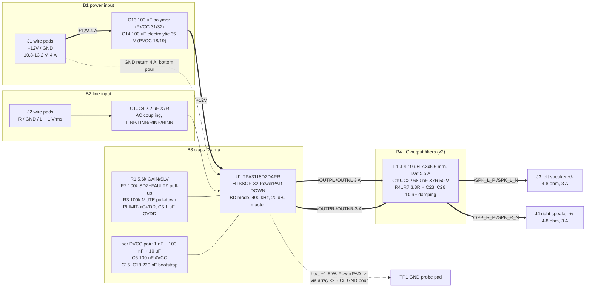

# PCB-0017-A stereo-class-d-amp - block architecture (P2)

Stereo class-D BTL amplifier on one 12 V rail, wire pads in and out, SMD only,
2 layers, JLC PCBA top side. Sources merged: `requirements.md` (delegate answers
accepted as written), `research/power.md|json`, `research/refdesign-amp.md|json`,
the component-scout fragments, and the orchestrator's `state.json` decisions,
which override research where they differ. Lead parts are named by MPN / part
class only; LCSC codes are P3's.

## Block diagram

Signal flow left to right (line in -> amp -> LC -> speakers); power enters at J1,
passes through the two bulk capacitors and reaches the two PVCC pin pairs at
opposite ends of U1's pin 17-32 side. Every ground on the board is one net,
`GND`, whose bottom-layer pour is both the current return and the heat spreader.

## B1 - power input (topology `dc-input`)

J1 is two SMD wire pads (about 3.0 x 6.0 mm each, >= 1.5 mm apart) for 18-20 AWG
leads, no connector, no reverse-polarity element and no TVS (Q3, Q7 - both
accepted; the risk is written up in `power_tree.md` section 5 and belongs in
`COMPARISON.md`). Bulk storage is two 100 uF parts, one at each PVCC pair as TI
and the reference design both do: C13 a 100 uF 25 V aluminium-polymer (ESR ~30 mOhm, >= 2 A rms
at 100 kHz - MA25V100M6x6 class, D6.3 x 6 mm SMD) at the pair nearest J1, and
C14 a 100 uF 35 V low-ESR aluminium electrolytic (RVT 100 uF 35 V class, same
D6.3 footprint) at the other pair, whose ~0.2 ohm ESR damps the hot-plug
resonance an all-polymer input would ring to ~2 x Vin. Lead: power.md section 6
(rejected: an all-MLCC 100 uF bank, 12-15 parts, size; a series Schottky, 1.6 W
at 4 A). The input path is sized for 4.0 A (13.2 V, 4 ohm, 10 % THD, both
channels) per the P1 decision that revised Q6 from 3 A.

## B2 - line input (topology `audio-line-in`)

J2 is three wire pads (R, GND, L). Each channel is AC-coupled single-ended into
the amplifier: C1/C3 2.2 uF X7R (0805, 50 V, CL21A225 class) from the pad to
LINP/RINP, and C2/C4 2.2 uF from LINN/RINN to GND so the unused inverting inputs
see the same source impedance. With Zi = 60 kOhm at 20 dB the corner is 1.2 Hz
(datasheet Table 2 recommends 1.5 uF; 2.2 uF is the reference design's value and is more bass
margin, not an error - refdesign decision 2). Input level is line level (~1 Vrms)
and gain 20 dB gives ~10 Vpk at the output, i.e. the amplifier clips at the rail
on a full-scale input, which is the intended operating point (Q12). Nothing else
sits in the path: no volume pot, no input RC other than the coupling cap (the
input RC time constant must stay <= 1 ms for the DC-detect start-up, power.md
section 9 - 60 k x 2.2 u = 0.13 s applies to the bias node only and is the
datasheet's own arrangement).

## B3 - class-D amplifier (topology `class-d-amp`)

U1 is the TI TPA3118D2DAPR, 32-pin HTSSOP with the PowerPAD DOWN. This is the
recorded deviation from the brief's TPA3116D2, which exists only as DAD (pad up)
and needs a top heatsink the reference design never modelled; the TPA3118D2 shares the SLOS708
datasheet, footprint, pinout, 120 mOhm rDS(on) and 3.2 ohm minimum load, and at
12 V nothing of the TPA3116D2's higher rating is usable (P1 decision, power.md
section 0). Operating point: PVCC 10.8-13.2 V, BD modulation (MODSEL pin 1 to
GND), 400 kHz (AM2/AM1/AM0 pins 13/14/15 all to GND - the datasheet's fSW table
row 0/0/0, the lowest idle loss and the ripple case the power research assumed),
master mode with 20 dB gain (R1 5.6 kOhm from GAIN/SLV pin 8 to GND, GVDD leg
open, Zi 60 kOhm), SYNC pin 16 left unconnected (it is an output in master mode;
the reference design's one intentional no-connect). PLIMIT pin 6 ties straight to GVDD pin 7 (no
power limiting, TI's own 12 V application); C5 1 uF X7R 25 V decouples GVDD.
SDZ pin 2 and FAULTZ pin 3 are joined into `/SDZ` and pulled to +12V through R2
100 kOhm so a thermal or short-circuit latch clears itself; MUTE pin 12 is held
low (outputs enabled) through R3 100 kOhm to GND - the reference design's two 100k parts, TI
Fig. 37's R19/R14. Decoupling per PVCC pair, nearest the pins first: 1 nF C0G
0603 (C7/C8), 100 nF X7R 50 V 0603 (C9/C10), 10 uF X7R 25 V 0805 (C11/C12 -
P1 decision: 0805 Basic part, not 1206), then the bulk from B1. AVCC pin 17
joins +12V with its own C6 100 nF at the pin. Four 220 nF X7R 50 V 0805
bootstrap caps C15-C18, each between its BSxx pin and its own OUTxx pin, never
shared. Dissipation design point 1.5 W (8 ohm full power at 13.2 V; 4 ohm music
is 0.8 W); sustained 4 ohm full-power sine (3.0-4.2 W) is recorded as NOT a
requirement and is left to the chip's 150 C thermal shutdown, which self-clears
via the FAULTZ-SDZ tie.

Rejected here: a switch-node snubber (10R + 330 pF per output, the EVM's
R11-R14) - not in the reference design's list and EMI is not a stated requirement (P1 decision);
a PLIMIT divider (three parts, would cap 4 ohm at ~9 W/ch to make the sine case
survivable - not asked for); a mute/fault LED (Q4).

## B4 - LC output filters, one per channel (topology `lc-output-filter`)

Each BTL output pair gets a second-order LC per leg: L 10 uH (SLO0630H100MTT
class, 7.3 x 6.6 mm shielded, Isat 5.5 A, Irms 4 A, DCR 66 mOhm - the peak
inductor current is 3.5 A at 13.2 V into 4 ohm and the 7.5 A overcurrent trip
needs >= 1 uH left) and C 680 nF X7R 50 V 0805 from the speaker net to GND.
f0 = 61 kHz, the datasheet's own BTL test condition and the reference design's pair; the LC app
note's tighter 73 kHz pairing (10 uH + 470 nF) was seen and not taken (refdesign
decision 9). A damping branch of 3.3 ohm 0603 + 10 nF X7R 50 V 0402 sits across
each speaker net to GND (R4-R7, C23-C26) so the filter stays damped from 4 to 8
ohm. The inductor is the size driver of the board: four 7.3 x 6.6 mm bodies plus
the 0805 caps and the two speaker pad pairs set the width of the output side.

## Interfaces the board presents

| pad | pins | net(s) | current |
|---|---|---|---|
| J1 | 1 +12V, 2 GND | `+12V`, `GND` | 4 A |
| J2 | 1 R, 2 GND, 3 L | `/IN_R`, `GND`, `/IN_L` | signal |
| J3 | 1 +, 2 - | `/SPK_L_P`, `/SPK_L_N` | 3 A |
| J4 | 1 +, 2 - | `/SPK_R_P`, `/SPK_R_N` | 3 A |
| TP1 | 1 | `GND` | probe |

Speaker outputs are bridge-tied: neither terminal is ground. Silkscreen must say
so and carry `PCB-0017 REV A` (boards CLAUDE.md).

## Count and cost picture

38 fitted parts (U1, 4 L, 7 R, 26 C) on 43 footprints (plus J1-J4, TP1) against
the reference design's 40 / 45. Our two extra fitted parts are the 10 uF per PVCC pair; our
missing ones are whatever the reference design fitted that its write-up did not name. Rough part
cost from research prices: U1 $1.08, inductors 4 x $0.11, bulk $0.17 + $0.05,
680 nF 4 x $0.04, 2.2 uF 4 x $0.05, the rest under $0.02 each - about $2.50 per
board in parts. Six part classes are JLC extended (U1, L, both bulk caps, the
680 nF, the 3.3 ohm), so PCBA carries roughly $18 of one-off loading fees. Fab
class: 2-layer, 2 oz copper, roughly 15 cm2 - the pricing table has no
copper-weight term, so the 2 oz adder is unquoted here; `order_quote` at P10 does
real numbers (this run stops at the fab package).
