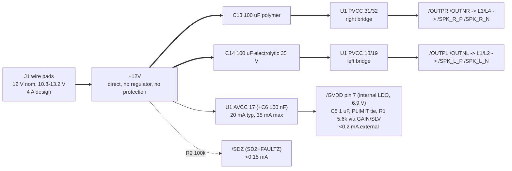

# PCB-0017-A stereo-class-d-amp - power tree (P2)

Lifted from `research/power.json` / `power.md` (research-power-architect, TI
SLOS708G cited as [DS]) and reconciled against the final block choices in
`blocks.md`. One external rail, no regulator; U1 makes its own analog and
gate-drive supplies internally.

## 1. Tree

## 2. Rail table

| net | source | topology | consumers | design current | dissipation on board |
|---|---|---|---|---|---|
| `+12V` | external adapter via J1, 10.8-13.2 V | direct | U1 both bridges (43 W in at 12 V / 4 ohm / 10 % THD, 52 W at 13.2 V); AVCC 20-35 mA; R2 pull-up < 0.15 mA | **4.0 A** (3.6 A at 12 V, 4.0 A at 13.2 V, both channels clipping into 4 ohm; music ~0.4 A) | U1 1.5 W design point (see 3); inductors 0.4-0.6 W total at full power |
| `GND` | J1 pin 2 | return / B.Cu pour | everything | **4.0 A** return | - |
| `/GVDD` | U1 internal LDO from AVCC | internal LDO, not a board rail | PLIMIT tie, GAIN/SLV divider (5.6k to GND), C5 | < 0.2 mA external [DS 6.5] | inside U1 |
| `/OUTPL` `/OUTNL` `/OUTPR` `/OUTNR` | U1 H-bridges | switch nodes, 400 kHz | L1-L4 | **3 A** each (3.1 A pk, 2.4 A rms at 13.2 V into 4 ohm; inductor peak 3.5 A) | in L (DCR 66 mOhm) |
| `/SPK_L_P` `/SPK_L_N` `/SPK_R_P` `/SPK_R_N` | L1-L4 | filtered outputs | 680 nF caps, damping branches, J3/J4 | **3 A** each | - |

Headroom: 4 A is already the full-clipping worst case at +10 % supply. Nothing
on the board can draw more - the adapter and U1's clipping bound it; U1's 7.5 A
overcurrent latch is a fault, not a design current. The `+12V` budget resolves
Q6's PROVISIONAL 3 A (state.json P1 decision "Q6 revised") and this is the value
H1 is asked to confirm.

## 3. Dissipation and the thermal design point

| case (both channels, 1 kHz) | P(U1) | Iin |
|---|---|---|
| 8 ohm full power, 13.2 V, 10 % THD | 1.5 W | 2.1 A |
| 8 ohm full power, 12 V, 1 % THD | 1.1 W | 1.5 A |
| 4 ohm music (1/8 power), 12 V | 0.8 W | 0.4 A |
| 4 ohm full power, 12 V, 1 % THD | 3.0 W | 2.9 A |
| 4 ohm full power, 13.2 V, 10 % THD | 4.2 W | 4.0 A |

Design point **1.5 W** at Ta 40 C with Tj <= 125 C (10 C under the lowest OT
trip), so the layout must reach RthJA <= 56.7 C/W. power.md's estimate for a
44 x 34 mm two-sided 2 oz pour with the pad-down part is ~30 C/W (+/-30 %), and
TI measured 22 C/W on its own 2-layer EVM copper with no heatsink [DS 6.4]; both
clear the target with margin. The 4 ohm full-power sine rows are recorded as
NOT a requirement (state.json P1 decision) - they would need ~50 x 50 mm of 2 oz
or PLIMIT - and are protected by thermal shutdown.

What check_thermal (P8) will say about this: its 2-layer screen floors at
73.8 C/W once the pour saturates at 645 mm2, so at 1.5 W it models a 111 C rise
against the 85 C allowance and will flag `thermal_vias`/area whatever the layout
does. The constraint stays honest (1.5 W, dt 85, >= 15 vias); the finding is
waived at P8 against the datasheet's 22 C/W EVM figure and power.md section 4,
not by lowering the numbers.

## 4. Decoupling scheme (datasheet-driven count)

Per PVCC pair, closest to the pins first, all returned to U1's GND pins/pad,
never through a long trace [DS 8.2.2.4, 10.1]:

| pair | 1 nF C0G 0603 | 100 nF X7R 50 V 0603 | 10 uF X7R 25 V 0805 | 100 uF bulk |
|---|---|---|---|---|
| PVCC 31/32 (right bridge) | C8 | C10 | C12 | C13 polymer 25 V, ESR <= 30 mOhm, >= 2 A rms |
| PVCC 18/19 (left bridge) | C7 | C9 | C11 | C14 electrolytic 35 V low-ESR (damps hot-plug ring) |

AVCC pin 17: C6 100 nF X7R at the pin, tied to +12V (TI joins 17/18/19).
GVDD pin 7: C5 1 uF X7R 25 V. Bootstraps: C15 BSNL-OUTNL, C16 BSPL-OUTPL,
C17 BSNR-OUTNR, C18 BSPR-OUTPR, 220 nF X7R 50 V 0805, each loop local to its own
pin pair. Everything on +12V is rated >= 25 V; the electrolytic bulk 35 V because
a hot-plug on ~200 uF of low-ESR capacitance can ring toward 26 V against U1's
27 V OV trip and 30 V absolute maximum.

`check_pdn` inventory: `+12V` is the only rail it should see (bulk: C13, C14,
C11, C12; ceramics: C6-C10). `GND` and the eight output nets are declared
`pdn: false` (returns and switch nodes, nothing decouples them by design).

## 5. Protection - none, and the risk in one line

Q7 accepted: no reverse-polarity element, no TVS, no fuse (like-for-like with
the reference design's ~40 parts). A reversed supply forward-biases U1's body diodes and
reverse-biases the polymer bulk cap, so only the adapter's current limit stands
between a miswire and a dead U1; a hot-plug can ring toward 26 V. If one part is
ever allowed, an SMBJ16A across J1 is the best value. This goes in COMPARISON.md.

## 6. Sequencing / start-up

One rail, no sequencing. UVLO 4.5 V, OVLO 27 V, self-clearing; turn-on ~10 ms.
SDZ is a plain 100k pull-up (no start-up hold), so the input coupling network
must not present a slow DC settle: the datasheet's own arrangement (2.2 uF into a
60 k bias) is what we have, and FAULTZ->SDZ auto-clears a nuisance DC-detect.

## 7. Copper the currents need (IPC-2152 outer layer, from `check_current`)

| current | 2 oz, dT 20 C | 1 oz, dT 20 C |
|---|---|---|
| 3 A (each output net) | 0.62 mm | 1.25 mm |
| 4 A (+12V and its return) | 0.88 mm | 1.76 mm |

On the chosen 2 oz stackup: draw `+12V` >= 1.0 mm and every output net
>= 0.8 mm (prefer local pours); >= 8 vias at 0.5 A each wherever `+12V` or its
return changes layer, >= 6 for an output. The necks into U1's 0.3 mm pins are
short and the parallel pin pairs (18/19, 31/32) share current. J1 pads connect
to their copper solidly or with four >= 1.0 mm spokes. The `+12V` trunk from the
first PVCC pair to the second must not cross the output tracks on F.Cu and must
not cut the >= 25 x 25 mm unbroken GND square under U1 on B.Cu - run it along
the board edge outside the LC filters, on either layer.
