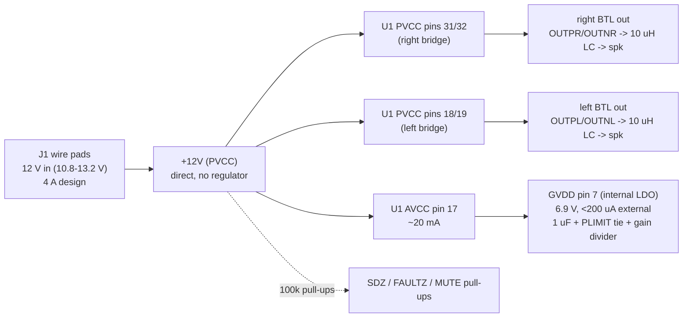

# P1 power architecture - PCB-0017-A stereo-class-d-amp (TPA3116D2, 12 V, stereo BTL)

Author: research-power-architect (P1), 2026-09-27.
Primary source: TI SLOS708G (TPA3116D2/TPA3118D2/TPA3130D2 datasheet, rev. Dec 2017), cited
as [DS section]. The reference design's parts from the JLCPCB blog post in the brief, cited as [Ref].
Numbers marked EST are my engineering estimates (+/-30% for thermal); everything else is cited.

## 0. Headline findings

1. **The TPA3116D2 cannot be heat-sunk through the PCB.** It exists only in the DAD package,
   "32-pin HTSSOP Pad Up" [DS 1, Device Information]; its RthJA of 14 C/W is measured with a
   14 x 50 x 25 mm heatsink on the top PowerPAD [DS 6.4 note 4]. There is no bottom pad, so
   thermal vias under it do almost nothing; heat leaves only through the leads. The reference
   write-up says "A suitable top heatsink or spreader is required, and it is not modeled anywhere in this
   release" [Ref]. The requirements' plan (pad vias to a bottom pour) only works with the
   **TPA3118D2 (DAP, pad down)**: same family, same footprint and pinout ("All three devices
   share the same footprint" [DS 3]), same 120 mOhm rDS(on) and 3.2 ohm min BTL load [DS 6.3,
   6.5], RthJA 22 C/W on TI's 2-layer EVM with no heatsink [DS 6.4], and "can even run
   2 x 30 W / 8 ohm without heat sink on a dual layer PCB" [DS 3]. At 12 V the extra rating of
   the TPA3116D2 is unusable (output is rail-limited), so the swap costs no audio performance.
   LCSC: TPA3118D2DAPR C46497, 38,915 in stock, $1.08 vs TPA3116D2DADR C50144, $1.04
   (parts_search, 2026-09-27). This is a deviation from the brief -> OPEN 1.
2. **Input current exceeds the provisional 3 A.** 2 x 4 ohm at 12 V draws 2.9 A at 1 % THD and
   3.6 A at 10 % THD; at 13.2 V it is 4.0 A. Size the +12V path and its GND return for 4 A.
   Speaker outputs: 3 A is enough (3.1 A peak at 13.2 V, 2.4 A rms worst) -> OPEN 2.
3. **44 x 34 mm, 2 layers, is enough for 8 ohm at full power and for 4 ohm music, not for
   sustained full-power 4 ohm sine at 40 C ambient** (Tj ~130 C at 1 % THD with the pad-down
   part on 2 oz; it trips at 10 % THD). Recommend 2 oz outer copper. -> OPEN 3.

## 1. Rail tree

One rail. No regulator is needed or allowed as an external supply: AVCC feeds the internal
LDOs, and GVDD "is not intended to be used for external supply" [DS 7.3.5, 9].

## 2. Rail table (budget, topology, dissipation)

| Net | Vin | Topology | Consumers (estimate, source) | Design current | Dissipation |
|---|---|---|---|---|---|
| +12V (PVCC+AVCC) | 10.8-13.2 V adapter | direct | U1 both bridges: 43.3 W in at 12 V/4 ohm/10 % (table 3); quiescent 20 mA typ, 35 mA max no load [DS 6.5] | 3.6 A at 12 V, 4.0 A at 13.2 V -> **4 A** (worst case already, +10 % over 3.6 A; music ~0.4 A) | U1: see section 4; inductors 0.4-0.6 W total |
| GVDD | internal LDO from AVCC | internal | gate drive + PLIMIT/GAIN dividers, IGVDD < 200 uA [DS 6.5] | <0.2 mA external | n/a (inside U1) |
| Speaker outputs x4 | from PVCC | H-bridge | 4 ohm: 2.8 A pk / 2.2 A rms at 12 V; 3.1 A pk / 2.4 A rms at 13.2 V | **3 A** per net; inductor peak 3.5 A | in U1 and L |

Headroom note: the 4 A figure is the full-clipping worst case at +10 % supply, which is the
headroom; I did not add a further 30 % because nothing on the board can draw more (the adapter
and U1's clipping bound it). Short-circuit current is limited by U1's overcurrent latch
(outputs "up to 7.5 A" [DS 7.1]) and is not a continuous design current.

## 3. Current budget (both channels driven, 1 kHz sine)

Model: Pout(1 %) = ((RL/(RL+2 RS)) x VP)^2 / (2 RL), Pout(10 %) = 1.25 x Pout(1 %) [DS 7.3.4
eq. 2], VP = PVCC, RS = 120 mOhm rDS(on) [DS 6.5] + 25 mOhm inductor DCR (EST). Losses: hot
rDS(on) 160 mOhm (EST, x1.33 at Tj ~100 C) x 2 FETs in series, 0.45 W idle/switching (EST:
20 mA quiescent [DS 6.5] plus BD-mode ripple, 0.75 A p-p per inductor at 400 kHz, 10 uH).
Resulting efficiency 90-93 %, consistent with DS Fig. 15/16.

| PVCC | RL | THD | Pout/ch | Iout rms | Iout pk | I(L) pk | P(U1) | Pin total | Iin |
|---|---|---|---|---|---|---|---|---|---|
| 10.8 V | 4 | 1 % | 12.7 W | 1.78 A | 2.52 A | 2.85 A | 2.5 W | 28.2 W | 2.6 A |
| 10.8 V | 4 | 10 % | 15.8 W | 1.99 A | 2.52 A | 2.85 A | 3.0 W | 35.2 W | 3.3 A |
| 12.0 V | 4 | 1 % | 15.6 W | 1.98 A | 2.80 A | 3.17 A | 3.0 W | 34.7 W | 2.9 A |
| 12.0 V | 4 | 10 % | 19.6 W | 2.21 A | 2.80 A | 3.17 A | 3.6 W | 43.3 W | 3.6 A |
| 13.2 V | 4 | 1 % | 18.9 W | 2.18 A | 3.08 A | 3.49 A | 3.5 W | 41.9 W | 3.2 A |
| 13.2 V | 4 | 10 % | 23.7 W | 2.43 A | 3.08 A | 3.49 A | 4.2 W | 52.3 W | 4.0 A |
| 12.0 V | 8 | 1 % | 8.4 W | 1.02 A | 1.45 A | 1.82 A | 1.1 W | 18.1 W | 1.5 A |
| 12.0 V | 8 | 10 % | 10.5 W | 1.14 A | 1.45 A | 1.82 A | 1.3 W | 22.5 W | 1.9 A |
| 13.2 V | 8 | 10 % | 12.7 W | 1.26 A | 1.59 A | 2.00 A | 1.5 W | 27.1 W | 2.1 A |
| 12.0 V | 4 | 1/8 power (music) | 2.0 W | 0.70 A | - | - | 0.8 W | ~4.8 W | 0.4 A |
| 12.0 V | 8 | 1/8 power (music) | 1.05 W | 0.36 A | - | - | 0.5 W | ~2.8 W | 0.25 A |

At 10 % THD the peak does not rise (the output is clipped at the rail); rms and heat do.
I(L) pk = load peak + half of the 0.75 A p-p ripple (400 kHz; 0.25 A p-p at 1.2 MHz).
Inductor (component-scout): Isat >= 4 A, and it must keep >= 1 uH at the 7.5 A OC trip
[DS 6.3 "Lo min under short-circuit 1 uH"].

## 4. Thermal (U1), no heatsink, Ta = 40 C, target Tj <= 125 C

The OT trip is 150 C +/-15 C and latches [DS 7.3.11], so 125 C keeps 10 C under the lowest
trip point. Allowed rise 85 C.

| Case | RthJA | Allowed P(U1) | 8 ohm full (1.1-1.3 W) | 4 ohm music (0.8 W) | 4 ohm full 1 % (3.0 W) | 4 ohm full 10 % (3.6 W) |
|---|---|---|---|---|---|---|
| TPA3116D2 DAD, no heatsink, 44x34 2 oz | ~45 C/W EST (lead conduction only; TI gives no figure) | 1.9 W | 90-100 C ok | 76 C ok | 175 C trips | trips |
| TPA3118D2 DAP, 44x34, 1 oz | ~35 C/W EST | 2.4 W | 80-85 C ok | 68 C ok | 145 C trips | trips |
| TPA3118D2 DAP, 44x34, 2 oz | ~30 C/W EST | 2.8 W | 73-79 C ok | 64 C ok | 130 C marginal | 148 C trips |
| TPA3118D2 DAP, TI EVM copper | 22 C/W [DS 6.4] | 3.9 W | ok | ok | 106 C ok | 119 C ok |
| TPA3116D2 DAD + 14x50x25 heatsink | 14 C/W [DS 6.4] | 6 W | ok | ok | ok | ok |

Basis of the EST values: a 44 x 34 mm board has ~3000 mm2 of two-sided surface; at ~14 W/m2K
(natural convection plus radiation from soldermask) a perfectly isothermal board is ~24 C/W
board-to-air, plus spreading (1 oz ~74 K/W per square, 2 oz ~37) and junction-to-board
(psiJB 4.7 C/W DAP [DS 6.4]). Scaled from TI's 22 C/W EVM figure; +/-30 %.

**Is 44 x 34 mm enough?** For 8 ohm at full power and for 4 ohm on music or program material,
yes, with the pad-down part (and also, with less margin, with the pad-up part). For sustained
full-power 4 ohm sine at 40 C, no: that needs about TI-EVM copper, roughly 50 x 50 mm of 2 oz
two-sided pour (EST), or PLIMIT, or a heatsink. Thermal shutdown protects the part either way.

**Recommend 2 oz outer copper.** It halves spreading resistance (~5 C/W off RthJA here, EST)
and halves the power widths below; JLC's 2-layer 2 oz floor is 0.1524 mm trace/space
(`reference/jlc_capabilities.yaml`), fine for the 0.65 mm HTSSOP pitch.

Copper and vias (for the DAP part):
- Thermal pad: via array 0.3 mm drill / 0.6 mm pad at 1.0-1.2 mm pitch filling the pad, at least
  15 vias (TI SLMA002 PowerPAD practice; exact pad size from the DS land pattern at P3). Tent on
  the bottom or accept slight wicking; do not leave the pad without vias.
- Top: GND pins 9, 22, 25, 28 and the pad joined in one solid top pour; extend it as far as the
  LC filter and bulk caps allow. PVCC pins in a wide top pour too (it carries heat as well).
- Bottom: unbroken GND pour under and around U1, >= 25 x 25 mm clear of cuts; bottom kept
  part-free (requirements section 7). Stitch top and bottom GND around U1 with a second ring
  of vias.
- For the DAD part the same pours help through the leads only; vias under the body do little.

## 5. Trace and pour widths (IPC-2152, outer layer)

Computed with the repo's own checker (`scripts/check_current.py` required_width_mm), so P8
enforces the same numbers.

| Current | 1 oz, dT 20 C | 2 oz, dT 20 C | 1 oz, dT 10 C | 2 oz, dT 10 C |
|---|---|---|---|---|
| 3 A | 1.25 mm | 0.62 mm | 1.80 mm | 0.90 mm |
| 4 A | 1.76 mm | 0.88 mm | 2.65 mm | 1.32 mm |

Use: +12V and its GND return at 4 A; each speaker output at 3 A. Prefer pours; where a
track is used on 2 oz, draw +12V >= 1.0 mm and outputs >= 0.8 mm. The necks into U1's 0.3 mm
pins are unavoidable and short; parallel pin pairs (31/32, 18/19) share current. Vias: default
0.5 A each, so >= 8 vias wherever +12V or its return changes layer, >= 6 for an output.

## 6. Decoupling (datasheet-driven count)

TI: bulk "two 100 uF ... one near the PVCC inputs at each side of the device ... low ESR"
[DS 8.2.2.3]; at each end of the chip "220 pF-1 nF" plus "100 nF-1 uF", X5R or better, as
close to the PVCC pins as possible, returned to the IC GND [DS 8.2.2.4, 10.1]. TI's
application circuit uses 1 nF + 100 nF + 220 uF per side [DS Fig. 37]. The reference design used two
100 uF 25 V low-ESR, 100 nF + 1 nF per PVCC pair and a separate 100 nF on AVCC [Ref].

Per PVCC pair (pins 31/32, and pins 18/19), placed in this order nearest the pins:
- 1 nF C0G/NP0 50 V 0402/0603 (HF, sets the switching-edge loop),
- 100 nF X7R 50 V 0603,
- 10 uF X5R/X7R 25 V 1206 (EST choice, not in DS: shares the 400 kHz ripple with the bulk; one
  per side). If size forces it, drop to 1 uF 25 V 0603 (the DS upper value).

Bulk: two 100 uF, one per side, as TI and the reference design do.
- Ripple: per channel the bulk bank sees roughly half the load peak at the switching frequency,
  ~1 A rms per channel at 4 ohm full power, ~1.5-2 A rms total (EST). A standard SMD aluminium
  electrolytic (100 uF 25 V, 6.3x7.7 mm) is rated ~0.2-0.3 A rms, ESR 0.3-1 ohm: not enough
  alone. An aluminium polymer 100 uF 25 V (6.3x7.7 or 8x10 mm) is rated ~2-3 A rms at 100 kHz,
  ESR 15-30 mOhm: fits.
- MLCC stack: a 22 uF 25 V X5R 1206 keeps ~6-8 uF at 12 V bias, so 100 uF needs 12-15 parts.
  Rejected on size and count.
- Damping: an all-low-ESR input (polymer plus MLCC) on a wired supply rings on hot-plug toward
  2 x Vin (26 V at 13.2 V), close to the 27 V OV trip [DS 7.3.8] and 30 V abs max. Some ESR
  damps it.
- Recommendation: side A 100 uF 25 V aluminium polymer (ESR <= 30 mOhm, >= 2 A rms); side B
  100 uF 25-35 V low-ESR aluminium electrolytic (ESR 0.1-0.3 ohm), which damps the lead
  resonance. If only one bulk fits, make it the polymer, keep the 10 uF on the other side, and
  consider TI's 3.3 ohm + 100 nF RC on PVCC [DS Fig. 37 R10/C58] plus the 10 nF at the input
  pads [DS Fig. 37 C57].
- Voltage: 25 V minimum on everything on +12V; 35 V preferred on the bulk given the ringing.

AVCC (pin 17): tie directly to +12V, as TI does (pins 17/18/19 joined in DS Fig. 37), with
the reference design's own 100 nF X7R 25 V at the pin (1 uF acceptable). No series resistor needed.

GVDD (pin 7): 1 uF X5R or better to GND [DS 7.3.5]; use 25 V 0603 X7R for DC-bias margin
(GVDD 6.4-7.4 V [DS 6.5]). Nothing else on GVDD but PLIMIT and the gain divider.
Gain: the reference design's R1 = 5.6 k to GND, R2 open = 20 dB master [DS 6.5 gain table]; it loads GVDD
with nothing. Bootstrap: 4 x 220 nF X5R+ >= 16 V (25 V preferred) [DS 7.3.6].

## 7. PLIMIT

Recommend **no limit: PLIMIT tied straight to GVDD**, as TI's own 12 V application does
[DS 8.2 "power limit not implemented", Fig. 37]. At 12 V the limiter's virtual rail (4 x
V(PLIMIT) = ~27 V with PLIMIT at GVDD [DS 7.3.4]) is far above PVCC, so it is inactive; setting
it only costs power. The one use for it here: if sustained full-power 4 ohm sine must never
trip thermal shutdown on 44 x 34 mm, a divider for V(PLIMIT) ~ 2.25 V (DS Table 3: 24 k to GND /
51 k to GVDD, plus the required 1 uF on PLIMIT [DS 7.3.4]) caps the swing at ~9 V peak, about
9 W/ch into 4 ohm, and cuts U1 loss to ~2 W (EST). Three extra parts; not recommended by default.

Related (P2's call): tie FAULTZ to SDZ with the pull-up, as TI does [DS Fig. 37, 7.3.11], so a
thermal or short-circuit latch clears itself instead of needing a power cycle.

## 8. Input protection and power pads

Reverse polarity / TVS (requirements Q7 = none): **risk in one line** - a reversed supply
forward-biases U1's H-bridge body diodes and ESD cells and reverse-biases the polymer bulk, so
only the adapter's current limit stands between a miswire and a dead U1 (and a possibly shorted
cap); a supply hot-plug can also ring toward 26 V against a 30 V abs max.
If one part is ever allowed, an SMBJ16A unidirectional TVS across the input (VWM 16 V > 13.2 V)
is the best value: it clamps the hot-plug ring and shunts a reversal until the adapter limits.
A series Schottky costs ~1.6 W at 4 A and is rejected; a P-FET ideal diode is 3-4 parts.

Input pads J1 (+12V, GND): wire 18 AWG (20 AWG acceptable for 4 A on short leads). SMD pad
3.0 x 6.0 mm each, >= 1.5 mm gap between + and GND, connected to the pours either solidly or
with 4 spokes >= 1.0 mm (2 oz) / >= 1.8 mm (1 oz), which carries 4 A per the table above.
The bulk capacitors sit between the pads and U1, with the input current path passing through
their pads before it reaches the PVCC pins.
Speaker pads J3/J4: same pad size is fine (3 A); 20 AWG wire.

## 9. Sequencing / inrush

- No sequencing between rails (only one). U1 UVLO at 4.5 V, OVLO at 27 V, self-clearing
  [DS 7.3.8]; turn-on 10 ms [DS 6.5].
- DC-detect nuisance faults: DS advises holding SDZ low at power-up until inputs settle
  [DS 7.3.9]; with a plain pull-up, keep the input RC time constant <= 1 ms [DS 7.3.7].
- Inrush: ~200 uF charged from the adapter through the leads; not a problem for U1, only the
  ringing noted in 6 and 8.

## 10. Hand-off notes for other phases

- component-scout / part-sourcer: TPA3118D2DAPR (C46497) if OPEN 1 goes that way; inductors
  10 uH Isat >= 4 A, >= 1 uH at 7.5 A, DCR <= 30 mOhm; bulk as in section 6.
- P2/P5: +12V 4 A, outputs 3 A, dT 20 C; 2 oz; thermal pad via array >= 15.
- COMPARISON.md: the reference design's board needs a top heatsink it does not model [Ref]; ours either
  swaps to the pad-down sibling or states the same limit.
