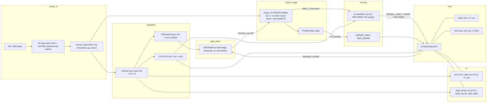

# PCB-0018-A bldc-motor-driver - block architecture (P2)

Three-phase BLDC/PMSM driver: VM 10-28 V (12-24 V nominal), 10 A RMS/phase continuous, 20 A peak
(both PROVISIONAL), 60 V power stage, 4 layers, single-sided SMD on top, JLC PCBA, qty 5.
Silkscreen must carry "PCB-0018 REV A" (repo rule; P6/P9 silk_place).

## Blocks and lead parts (MPN/part class; LCSC codes are P3's job)

**power_in.** VM enters on two large plated pads beside the phase pads. A high-side N-FET (NTMFS5C628NL,
the same 60 V part as the power stage, one BOM line fewer) driven by LM74500-Q1 gives reverse-polarity
protection while conducting in both directions, so regen current can return to the supply; an ideal-diode
controller (LM74700) would block it and pump the bus. After the FET: SMCJ28A TVS (28 V standoff, 45.4 V clamp
at 33 A), two 470 uF / 63 V THT electrolytics (C101, C104; two share the bus ripple current) for low-frequency ripple and hot-plug damping, and a 100 nF + 10 uF
MLCC at the entry. No onboard fuse, no hot-swap, no brake chopper (recorded decisions; external 20 A slow fuse
assumed, firmware limits regen on VBUS_SENSE).

**regulators.** LM5164 (100 V, 1 A synchronous COT buck, SO-8 PowerPAD) makes +5V straight from VM; 100 V
covers the 45 V clamp and the ~56 V hot-plug ring with margin. TPS61040 (5 V -> 12 V boost, 400 mA switch)
makes +12V for the driver's GVDD. TLV75733 (1 A LDO) makes +3V3 from +5V; VDDA through a ferrite.

**gate_driver.** DRV8300D (VQFN-24, integrated bootstrap diodes, GVDD 5-20 V, SHx 85 V recommended / 110 V abs,
BSTx 105 V) in 6-PWM mode, dead time set by the DT resistor, GVDD = +12V. 1 uF bootstrap caps per phase,
10 uF + 1 uF on GVDD. High-side VGS is about 11 V at every VM from 10 V to the clamp, low-side 12 V.
Overcurrent protection is the MCU's job: CSA outputs also feed STM32G4 comparators wired to TIM1 break.

**power_stage.** Three legs, each: HS + LS NTMFS5C628NL (60 V, SO-8FL 5x6, ~2 mOhm @10 V, Qg ~52 nC),
10 ohm series gate resistor + 10 k gate-source pull-down per FET, a 3 mOhm 2512 3 W shunt from LS source to GND
with Kelvin taps at the shunt's own pads, 3x 10 uF / 50 V X7R 1210 + 100 nF directly across that leg (HS drain to
shunt GND), and DNP RC snubber footprints across each FET. Phase outputs on large plated pads.

**sensing.** INA240A1 (gain 20, 400 kHz, CM -4 V to 80 V, PWM rejection) per phase, REF1 = +3V3 and REF2 = GND
so the output idles at 1.65 V: 3 mOhm x 20 = 60 mV/A, +-27 A full scale, 20 A peak = +-1.2 V. RC filter at the
CSA inputs (TIDA-010251 practice). Phase and bus dividers 150 k / 10 k (1:16) with 100 nF-class filter caps,
so the 45 V clamp reads 2.8 V at the ADC.

**mcu.** STM32G431CBT6 (LQFP-48, 170 MHz, 2 ADCs, 4 COMP, TIM1 advanced). HSI16 clock (no crystal needed for
UART/FOC). nRST button, user button, LEDs: power (+3V3), status, fault. BOOT0/PB8 pulled down and not
used for a sensor input. SWD on a 1.27 mm 2x5 SMD header (standard ST-Link/J-Link cable; Tag-Connect needs a
cable the owner may not have).

**io.** Control: JST-GH 4-pin (GND, +5V out through a 0.2 A PTC, UART TX, RX) with series 100 ohm + ESD.
Sensor: 8-pin (5V via 0.2 A PTC, GND, HA, HB, HC, ENC_A, ENC_B, ENC_Z) with 4.7 k pull-ups to +3V3 (Halls are
open-drain; 5 V push-pull encoders land on FT pins) and 100 ohm / 1 nF filters. Four M3 corner holes.

## Conflicts resolved (which source lost, and why)

1. **Gate-drive supply: power.md's 12 V boost wins over the scout's DRV8320H charge pump.** DRV8320's own
   datasheet (Electrical Characteristics, VVM = 10 V) guarantees only 6.3 V min high-side and 7.5 V min low-side
   gate drive, which fails the Answers #5 floor of VGS >= 8 V at VM = 10 V. DRV8300D + boost gives ~11 V at any VM,
   costs $0.59 vs $2.76, and its HV pins (85 V) sit far above the clamp. The cost is one small boost and losing
   DRV8320's VDS overcurrent monitor, replaced by the MCU comparator break. (Also: the scout's DRV8320 LCSC code
   C112188 does not match the live listing, C701782 - moot now.)
2. **FET: TDM3436 (40 V) rejected** for the recorded 60 V decision (45 V TVS clamp). Lead NTMFS5C628NL, alt
   BSC028N06NS (2.8 mOhm, same footprint class).
3. **Buck: TPS54331 (28 V) rejected**, MP1584 (28 V) rejected. LM5164 (100 V) lead; TPS54360 (60 V, 65 V abs,
   async, needs a 60 V Schottky) alternate.
4. **CSA: scout's INA181A2 loses to INA240A1.** At gain 50 with a mid-supply reference, 3 mOhm saturates at
   +-11 A; INA181 has one REF pin that needs a low-impedance 1.65 V source, and its -0.2 V common-mode floor is
   thin against ground bounce at the shunt. INA240's REF1/REF2 split makes mid-supply with no extra parts.
5. **Divider: refdesign's 1:11 changed to 1:16**, because 1:11 puts the 45 V clamp at 4.1 V on an ADC pin.
6. **Gate drive for 60 V FETs**: power.md's 12 V VDRV is kept; the brief's "bootstrapped high side" is honoured.

## Decisions to log
- Stackup JLC04162H-7628A, 4 layers, 2 oz outer / 0.5 oz inner (current and heat spreading, no heatsink).
- Lead parts: STM32G431CBT6, DRV8300D (RGE), NTMFS5C628NL x7, INA240A1, LM5164, TPS61040, TLV75733,
  LM74500-Q1, SMCJ28A, 3 mOhm 2512 3 W shunts, 470 uF / 63 V electrolytic.
- Rejected: DRV8320H (VGS min at 10 V), TDM3436 (40 V), TPS54331/MP1584 (28 V), INA181A2 (range/REF), 1:11 divider.
- Size is an output: no brief dimension is binding; ~60 x 60 mm is what the parts and the 3.5 W loss need
  (see power_tree.md, Thermal), so no relaxation to record.
