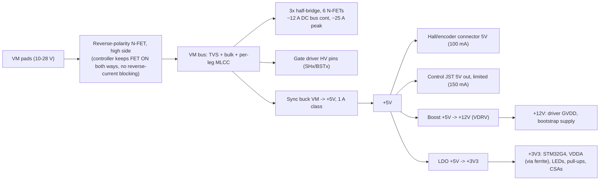

# PCB-0018-A bldc-motor-driver - power architecture (P1, research-power-architect)

Inputs: requirements.md incl. Answers (VM 10-28 V operating, 10 A RMS/phase, 20 A peak, both PROVISIONAL;
gate drive VGS >= 8 V at VM = 10 V and inside abs max at 28 V + transient). No component-scout fragment
existed yet, so consumer currents below come from class-typical datasheet figures (cited per line);
component-scout/part-sourcer must re-check them against the chosen parts.

## Rail tree

## Gate-drive supply decision (Q5)

Chosen: **+12V gate-drive rail from a small boost off +5V**, feeding a bootstrap 3-phase (or 3x half-bridge)
driver's GVDD/VCC. Low-side VGS = 12 V; high-side VGS = 12 V - Vf(boot diode ~0.6 V) - droop (<0.3 V with
Cboot >= 10x Qg) ~= 11 V, **at every VM from the buck's dropout (~6 V) to 28 V + transient**. The driver's
GVDD never sees VM, so a 45 V TVS clamp only has to be survived by the HV pins (SHx/BSTx: pick a driver
rated >= 60 V there, e.g. 100 V-class). Meets both the brief's >= 10 V and the Answers' >= 8 V.

Alternatives rejected:
- Driver GVDD straight from VM: bootstrap drivers top out at ~20-25 V GVDD abs max; 28 V + transient breaks it.
- 12 V LDO from VM: tracks VM below 12 V (VGS ~9.5 V LS / ~8.7 V HS at VM = 10 V, 0.7 V margin only) and
  burns (28-12) x 30 mA = 0.48 W at 28 V. Works, but thinner margin and hotter than the boost.
- Charge-pump "smart" drivers (DRV835x-class) avoid bootstrap but the brief asks for a bootstrapped high side.

Firmware/driver notes: bootstrap cannot hold 100 % duty - cap modulation (SVPWM max duty ~95-97 %) and
pre-charge Cboot by pulsing low sides before the first high-side turn-on. Gate pull-downs (10k-100k gate-source)
keep FETs off while +12V is absent or the MCU is in reset; driver UVLO on GVDD and per-BST is required.

## Topology and budget table

Headroom = 30 % on the design sum. "cite" = source of the per-consumer number.

| Rail | From | Topology | Consumers (typ / design) | cite | Design I | Dissipation |
|---|---|---|---|---|---|---|
| +3V3 | +5V | LDO, 300 mA class | STM32G4 @170 MHz, ADC/OPAMP/COMP on: 40 / 60 mA | STM32G474 DS run-mode table (~200 uA/MHz + analog) | | |
| | | | 3 LEDs @2 mA: 6 mA | LED setting | | |
| | | | 6 sensor pull-ups 4.7k (if to 3V3): 4.2 mA worst | V/R | | |
| | | | 3 ext. CSAs (if not MCU OPAMPs): 1.5 mA | INA181/INA240-class Iq ~0.5 mA | | |
| | | | sum 72 mA x1.3 | | **0.1 A** | (5-3.3)x0.1 = **0.17 W** |
| +12V (VDRV) | +5V | boost, >= 0.5 A switch | 6 FET gates: 6 x Qg 60 nC x 30 kHz = 10.8 mA | Qg @10 V of 60 V ~2-3 mOhm 5x6 FETs (BSC028N06NS-class ~40-60 nC) | | |
| | | | driver quiescent ~2 mA | DRV8300-class GVDD Iq | | |
| | | | gate pull-downs 6 x 10k (when on) ~3.6 mA avg | V/R | | |
| | | | sum 16 mA x1.3 = 21 mA; rail sized to 50 mA (fsw/Qg margin) | | **0.05 A** | (1-0.85)x0.6 W = **0.1 W** |
| +5V | VM | sync buck, 1 A class, VIN abs max >= 60 V | Hall/encoder 5V: 100 mA | 3 Halls ~10 mA ea; optical enc. up to ~100 mA | | |
| | | | control JST 5V out, limited: 150 mA | Answers #1 ("fused/limited"), our limit | | |
| | | | +3V3 LDO input: 100 mA | row above | | |
| | | | boost input: 12 V x 50 mA / 0.85 / 5 V = 141 mA | row above | | |
| | | | sum 491 mA x1.3 = 0.64 A | | **0.64 A (1 A part)** | (1-0.85)x3.2 W = **0.44 W** at design load, ~0.15 W typ |
| VM | pads | reverse-polarity N-FET + TVS + bulk | motor stage: I_dc = 3 x (VM/sqrt6) x 10 A = 12.2 A cont (SVPWM, PF=1); 24.5 A at 20 A peak | inverter power balance | **12.2 A cont / 25 A pk** | RP FET 1.5 mOhm hot: **0.22 W** cont, 0.9 W peak |

Total input power: motor output up to VM x 12.2 A = 342 W at 28 V (122 W at 10 V); board self-loss ~3.5 W
(power stage ~2.5 W, RP FET 0.2 W, logic rails ~0.7 W design / ~0.3 W typ). Logic rails are < 3 W at the
input, so the buck is the only regulator anywhere near the 0.5 W flag.

## VM protection

- **Reverse polarity: high-side N-FET (40-60 V, <= 1.5 mOhm, 5x6) driven by a charge-pump reverse-polarity
  controller that keeps the FET fully on in both directions (LM74500-class, not an ideal-diode LM74700).**
  Reason: a motor drive regenerates; an ideal diode blocks the return current and the bus pumps up.
  Low-side (GND-path) FET rejected: it offsets board GND from the host's GND at 12-25 A, and the UART/sensor
  grounds would carry motor return current. P-FET rejected: ~4 mOhm at 25 A = 0.6 W cont.
- **TVS across VM after the RP FET**: 28 V standoff, 600 W (SMBJ28A-class) or 1500 W (SMCJ28A-class);
  VBR ~31 V, Vc ~45 V at rated Ipp. **A 45 V clamp exceeds 40 V FETs**, so the power stage should be **60 V**
  FETs (brief/Answers say 40 V, PROVISIONAL - see OPEN). Every VM-connected IC (buck, RP controller, driver
  HV pins) is specified >= 60 V abs max.
- **Regen/overvoltage**: the TVS is not a brake. A bench PSU cannot sink regen current, so VM rises on
  braking. Firmware must limit braking current on VM sense (bus divider exists) and clamp before ~32 V; a
  brake chopper is out of scope for this board.
- **Fuse**: pads only, no onboard fuse proposed (a 25 A SMD fuse is large and adds ~2 mOhm). An external
  inline fuse, 20 A slow, is assumed - see OPEN.
- **Hot-plug**: a low-ESR ceramic bank alone rings to ~2x VM (56 V at 28 V). The electrolytic's ESR damps it;
  keep one electrolytic on the bus (the frame shows one) and the TVS within ~10 mm of the VM pads.

## Bulk capacitance and ripple current

- Bus capacitor RMS ripple (Kolar/Ertl formula, SVPWM): worst case **6.5 A RMS at 10 A RMS/phase** (M ~0.6,
  PF = 1); scales linearly with phase current (13 A RMS at 20 A peak, short).
- Voltage ripple, cap-only worst case: dV = I x T / (4 C) with 20 A, 40 us (25 kHz): C >= 400 uF for 0.5 V.
- Bank:
  - **MLCC: 3 x 10 uF / 50 V X7R 1210 per half-bridge (9 total) + 100 nF 0603 at each high-side drain**;
    they carry the fsw ripple (~2 A RMS each class rating, ~12 uF effective at 28 V DC bias total ~12-15 uF).
  - **Electrolytic: >= 470 uF / 50 V (63 V preferred) low-ESR or hybrid polymer, THT, ripple rating >= 2.5 A
    at 100 kHz**, near the RP FET output. If one can will not take the low-frequency share, use two
    (10 mm-class) rather than a taller single can.
  - 50 V minimum rating on everything on VM: 35 V parts sit under a 45 V TVS clamp.

## Thermal flags (first pass, feed P2/P6/P8)

| Item | Loss | Note |
|---|---|---|
| Power stage (6 FETs) | ~1.1 W conduction (10 A RMS, 3.75 mOhm hot, per phase I^2R) + ~0.9 W switching (28 V, 25 kHz, ~100 ns edges) | **> 0.5 W: the board's hot spot**; no heatsink - 10 A RMS may be derated by P2/P8 thermal |
| Shunts (3) | ~0.1 W each at 2 mOhm | Kelvin, near low-side sources |
| Buck +5V | 0.44 W design, 0.15 W typ | just under the flag; pour + vias under its pad |
| RP FET | 0.22 W cont, 0.9 W at 25 A peak | shares the VM pour |
| +3V3 LDO | 0.17 W | fine |
| Boost +12V | 0.1 W | fine |

## Sequencing / inrush

- +12V must reach UVLO before the MCU enables PWM; MCU holds driver EN low until it reads VDRV-good (driver
  UVLO flag or a divider) - no hardware sequencer needed. Boost enable tied to +5V is fine.
- VDDA = +3V3 through a ferrite + 1 uF/100 nF; internal VREFBUF for the shunt ADC.
- Bus inrush at plug-in is unlimited (no hot-swap controller); acceptable for a bench prototype - see OPEN.
