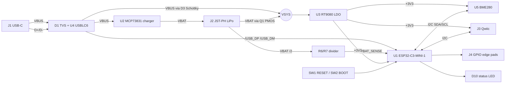

# blocks - esp32c3-node (P2)

## B1 usb-c sink + protection
USB-C 2.0 receptacle (TYPE-C-31-M-12 class), independent 5.1k Rd on CC1/CC2 (default USB,
<= 500 mA, no PD). SMF5.0A-class TVS on VBUS at the receptacle; USBLC6-2SC6 on D+/D- next to
J1, before the pair runs to the module. No series resistors (module's internal PHY).

## B2 charger + power path
MCP73831T-2ACI/OT linear charger, 4.20 V, RPROG 5.1k -> ~196 mA (provisional 0.5C of a
400 mAh cell). Load sharing per Microchip AN1149: AO3401A PMOS (drain VBAT, source VSYS,
gate VBUS with 100k pull-down) passes the battery only when VBUS is absent; B5819W Schottky
feeds VSYS from VBUS. Charge LED (red) from STAT. No NTC (provisional, protected cell).

## B3 3.3 V LDO
RT9080-33 (600 mA, ~2 uA Iq, ~300 mV dropout at 500 mA). VSYS -> +3V3, EN tied to VSYS.
1 uF in/out ceramics. Battery divider 1M/1M + 100 nF into IO3 (ADC1_CH3).

## B4 ESP32-C3-MINI-1-N4 module
PCB-antenna module. 10 uF + 100 nF at 3V3; EN 10k/1 uF RC + RESET button; IO9 BOOT button
with 10k pull-up; IO8 and IO2 10k pull-ups (strap levels); native USB on IO18/IO19.
Status LED on IO10 (not a strap). Spare IO0,1,2,4,5,8,20,21 on 0.1 in edge pads.
Antenna at the board edge with the datasheet keep-out free of copper on every layer.

## B5 BME280 + Qwiic
BME280 (LGA-8, I2C, SDO->GND = 0x76, CSB->VDDIO). 4.7k pull-ups on IO6 SDA / IO7 SCL,
shared with the Qwiic JST-SH 4-pin (GND/3V3/SDA/SCL). >= 10 mm from U1/U3/U2, no pour under U5.
