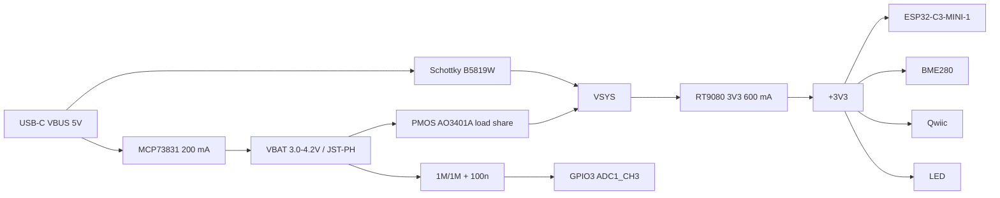

# power - rail tree (power architect, P1)

| rail | source | topology | I budget | consumers (estimate, source) | dissipation |
|---|---|---|---|---|---|
| VBUS | USB-C | direct | 0.50 A entitlement (default USB) | charger 0.20 A + VSYS 0.25 A avg | Schottky 0.45 V x 0.25 A = 0.11 W |
| VBAT | cell | direct | 0.20 A charge / 0.45 A discharge peak | charger out, PMOS, divider 2.1 uA | PMOS 0.45^2 x 0.07 = 14 mW |
| VSYS | VBUS via D1 or VBAT via Q1 | direct (OR) | 0.45 A peak | LDO input | - |
| +3V3 | VSYS | LDO | 0.45 A peak, ~0.20 A sustained | module 350 mA TX peak (module DS v2.2 6.4), ~100 mA WiFi avg (ASSUMED); BME280 < 1 mA; LEDs 2x ~1.3 mA; Qwiic reserve 100 mA | see below |

Headroom: 0.45 A peak x 1.3 = 0.59 A < RT9080 610 mA min limit (tight; the 100 mA Qwiic
reserve is a ceiling, not a typical load).

LDO thermal (theta-JA 230.6 C/W, RT9080 DS): worst sustained on USB, VSYS 4.9 V
(5.25 - 0.35), 0.20 A -> 0.32 W -> +74 C -> Tj 114 C at 40 C ambient (below the 150 C
shutdown, above comfort). Typical (5.0 V bus, 0.12 A) -> 0.20 W -> +46 C. On battery
(3.7 V) the loss is < 0.1 W. TX peaks are ms bursts and average out thermally.
Thermal constraint: LDO gets a copper pad spread on its GND/VIN/VOUT pins, and the BME280
sits >= 10 mm from it (self-heating corrupts T/RH).

USB entitlement: charger 0.20 A + system 0.25 A avg = 0.45 A <= 0.50 A default USB.
Attach capacitance on VBUS: charger 4.7 uF + VSYS caps behind the Schottky (the diode
does not block inrush) -> keep VBUS + VSYS bulk <= 10 uF (USB2.0 7.2.4.1, via
reference/interfaces/usb-fs.md).

Safety (P0 provisional): charge current 196 mA (RPROG 5.1k), no NTC, protected cell.
