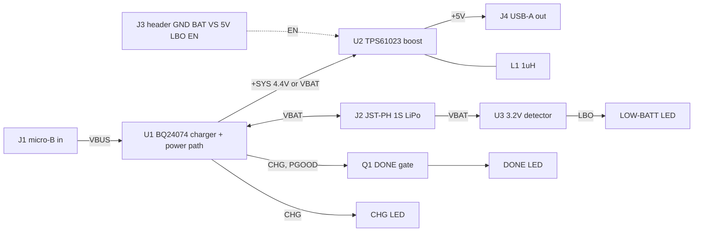

# Blocks - PCB-0021-A lipo-boost (all choices PROVISIONAL, owner-delegated)

Power flows left to right; signal nets are CHG, PGOOD, LBO, EN.

- **Charger / power path (U1)**: BQ24074RGTR (TI). OUT fixed 4.4 V keeps +SYS under 5 V so the boost never passes USB through to USB-A. ISET 887 R (~1.0 A), ILIM 1.07 k (~1.5 A; EN2=1, EN1=0 selects ILIM mode), TS to fixed 10 k to GND (no NTC), TMR ~49.9 k, ITERM left at default 10 % unless P3 reads otherwise, CE low. 10 uF on OUT, 4.7 uF-class on IN, 4.7 uF on BAT per datasheet. Hot part (~1.1 W worst case): thermal pad vias.
- **Boost (U2)**: TPS61023DRLR (TI), VIN=+SYS, FB 732 k / 100 k (~4.95 V), EN pulled up to +SYS by 100 k and brought to header. Cin 10 uF, Cout 2 x 22 uF 0805 X5R >= 10 V (+ small HF cap). L1 1 uH, Isat >= 4 A, DCR <= 30 mohm, 4x4 class (P3 picks). Tight SW loop: Cin - U2 - L1 on one side.
- **LEDs**: D1 CHG (orange): +SYS - R - D1 - CHG. D2 DONE (green): +SYS - R - D2 - Q1 drain; Q1 (small N-MOSFET) gate = CHG with 100 k pull-up to +SYS, source = PGOOD. Conducts only when PGOOD is low (USB valid) and CHG is high-Z (not charging). One FET, no inverter. D3 LOW-BATT (red): +SYS - R - D3 - LBO.
- **Low-batt detector (U3)**: open-drain voltage detector ~3.2 V sensing VBAT; its output is the LBO net (LED sink and header pin). Part class only here; P3 sources from JLC stock (TLV803 family has no 3.2 V; fall back to a comparator + divider, or 3.1 V detector). LBO is open drain, no pull-up on board (LED branch is the load), documented on the header.
- **Connectors**: J1 USB micro-B SMT, power only (D+/D-/ID unconnected); J2 JST-PH 2-pin (S2B-PH-SM4-TB class, SMT, silk +/-; pin 1 = +, Adafruit convention); J3 7-pin 2.54 mm header (GND, BAT, VS, 5V, LBO, EN, plus a spare GND); J4 USB-A receptacle, THT right-angle, D+/D- joined by a 0 R (R_DCP).
- **Rejected**: bq24072 (OUT=VBAT+225 mV, more heat at low cell), bq24075 (5.5 V OUT breaks 5.25 V USB-A limit), MCP73871 (stock 112, $2.79), IP5306 (no EN/LBO), TPS61090 (12x cost). No PTC/eFuse on +5V and no reverse-battery FET (brief Q9; silk warning instead). Both PROVISIONAL; a miswired third-party JST pack can still damage the board.
