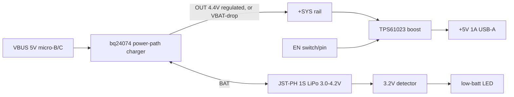

# PCB-0021-A power architecture (P1)

Brief: USB 5 V in -> 1S LiPo charge (~1 A) with load sharing -> 5 V / 1 A boost -> USB-A. EN pin, low-batt + CHG/DONE LEDs.
Sources: TI bq24074 datasheet (SLUS810, device table + sec 9.3), TI TPS61023 datasheet (SLVSF14B), Adafruit 1000C learn guide.
See parts-scout.md for LCSC numbers, reference-adafruit-powerboost1000c.md for the comparison base.

## Tree

## Rails
| Net | Source | Topology | Budget | Dissipation (first pass) |
|---|---|---|---|---|
| VBUS | USB in | direct | Iin max 1.5 A (ILIM) | cable/connector only |
| +SYS | bq24074 OUT | power-path: IN->OUT regulated 4.4 V (LDO-like), BAT->OUT FET when USB absent/short | boost Iin + charge | see below |
| VBAT | JST-PH | direct | charge 1 A (ISET), discharge up to ~2 A | cell |
| +5V | TPS61023 | sync boost | 1.0 A out (+30% margin: part limit 3.7 A valley) | ~0.4-0.6 W |
Consumers on +5V: USB-A load only (1 A is the brief; ~1.3 A margin target). Indicator LEDs ~1-2 mA each, from +SYS or VBUS.

## Load sharing (power path)
bq24074 does it in silicon: the load (+SYS) is fed from USB first; the charge current is what is left of the input limit; if the load exceeds the input limit, DPPM/battery-supplement mode pulls the shortfall from the cell. USB removal flips OUT to the battery through an internal FET with no break at the output. Same function as the MCP73871 on Adafruit's board.
- Why bq24074 (OUT = 4.4 V fixed): OUT stays below 5 V so the boost always boosts and never sits in pass-through (TPS61023 passes Vin to Vout when Vin>Vout; a 5.5 V OUT variant such as bq24075 would put 5.3-5.5 V on the USB-A while plugged in, over the 5.25 V USB limit). bq24072 (OUT = VBAT+225 mV) was rejected: at low battery OUT is ~3.6 V and IN->OUT dissipation doubles.
- Input current limit: ILIM resistor (EN1=0, EN2=1): Iin = 1610 A*ohm / RILIM (500 mA-1.5 A range). Set 1.5 A (about 1.07 kohm; use E96 1.07k). Charge current ISET: Ichg = 890 A*ohm / RISET (590 ohm-8.9 kohm); 1 A -> 890 ohm. Both from datasheet K factors, verify at P2.
- Full load while charging: boost Iin at OUT=4.4 V is 5.0*1.0/(0.92*4.4) = 1.24 A, leaving ~0.25 A for charging inside a 1.5 A limit. Charging slows to a trickle under full load; that is inherent (Adafruit is the same with its 1.8 A cap). Say so in the spec.
- TS pin needs a 10 kohm NTC to the cell or a fixed 10 kohm to VSS. JST-PH pack has no NTC -> fixed 10 kohm (loses cell over-temp protection; flag).
- TMR: 18-72 kohm sets safety timers; ITERM (bq24074) default 10% of ISET if left open.
- LEDs: CHG pin is open-drain low while charging, high-Z when done; PGOOD low when valid input. CHG LED = orange; DONE green = PGOOD LED AND NOT CHG. The simplest correct DONE is one small N-FET/NPN inverting CHG, green LED lit while "PGOOD low and CHG high". Decide at P2 (OPEN 3).

## Boost sizing (5.0 V, 1 A, Vin 3.0 - 4.4 V)
- Vout set with divider: Vout = 0.595 V*(1+R1/R2); TI example R1=732k, R2=100k gives ~4.96 V; use 750k/100k (5.06 V) or 732k/100k plus 1% parts. Keep R2 < 300 kohm.
- Worst case Iin(DC) = 5*1/(3.0*0.88) = 1.9 A (TI eq. 5, eta 88% at 3 V); 1 uH, f ~1 MHz, D = 0.4: dI(p-p) ~ 1.2 A (1.7 A at -30% L). Peak ~2.8 A; valley limit 3.7 A typ (2.7 A min) leaves room, Isat should be >= 4 A, margin to 5 A+ preferred.
- Inductor: 1 uH (TI range 0.37-2.9 uH), Isat >= 4 A, DCR <= 30 mohm, 4x4 mm class. Copper loss at ~2 A rms ~0.1 W.
- Cin 10 uF (>= 4.7 uF effective), Cout 2 x 22 uF 0805 X5R >= 10 V (TI example; effective C falls 50-70% at 5 V bias, TI minimum is 4 uF effective). Add 10 uF at bq24074 OUT per its datasheet typical app.
- Efficiency: TI quotes 94% at 3.6 V in, 5 V out (load point read from the headline; not verified at 1 A). My estimate 90-92% at 3.0 V/1 A, ~94% at 3.6-3.8 V. Battery-only runtime: P_in ~5.4 W at 1 A.
- PFM/power-save at light load (IQ ~20-30 uA from VOUT); EN low = true disconnect (shutdown 0.1 uA).

## Thermal (first pass)
- Boost: (1-0.91)*5.0 W = ~0.45 W total in IC + inductor; IC share ~0.25 W; RthJB 31 C/W (TI) -> <10 C rise. OK on 2 layers with ground pour.
- Charger, worst case plugged in, full load, charging: LDO-like IN->OUT drop (5.0-4.4)*1.5 A = 0.9 W plus charge FET (4.4-3.6)*0.25 A = 0.2 W -> ~1.1 W in a 3x3 QFN. Above the ~0.5 W flag. Needs thermal-pad vias and copper pour; the part thermal-regulates at 125 C (reduces charge current) so it self-protects but throttles. Add to thermal constraints list.
- Alone charging at 1 A with 3.6 V cell: (4.4-3.6)*1 A = 0.8 W also hot; consider ISET 0.7-0.8 A as a default (OPEN 1).

## OPEN (blocking, safety)
1. Charging a LiPo: cell capacity is unknown. 1 A is 1C only for a 1000 mAh cell; a smaller cell needs ISET lowered. Owner to confirm the minimum cell size or a jumper/resistor option.
2. No cell NTC on JST-PH: confirm TS tied to fixed 10 kohm is acceptable.
3. DONE LED logic (inverter vs. PGOOD green).
4. Output short-circuit: a boost has no output isolation in pass-through/short. Decide on a PTC/e-fuse on +5V (Adafruit has none).
5. JST-PH polarity: third-party packs are reversed; add reverse protection or a silk warning (Adafruit warns of this).
